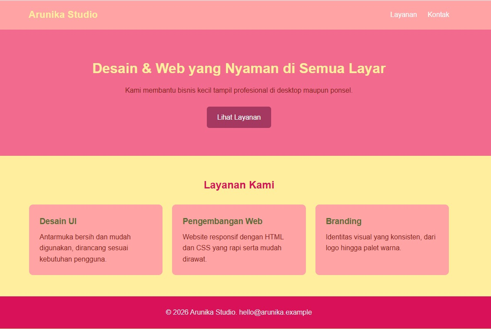

# Tugas Praktikum: Landing Page Arunika Studio

**Nama       :** [Nur Wahyu Muhti]
**NIM / Kelas:**[4525210078 / A]
**Mata Kuliah:**[Praktikum Desain Web]
**Jenis tugas:**Individu

## 1. Source Code / Folder Project

```
arunika-studio/
├── index.html     # struktur halaman (header, hero, 3 layanan, footer)
├── style.css      # seluruh aturan tampilan
├── images/
│   ├── desktop.png
│   └── mobile.png
└── README.md
```

Cara menjalankan: buka `index.html` langsung di browser. Tidak perlu instalasi tambahan.

## 2. Screenshot Hasil

**Desktop**: tiga card layanan tampil dalam tiga kolom.




## 3. Ringkasan Perubahan, Masalah, dan Solusi

Proyek ini membangun landing page sederhana untuk Arunika Studio yang terdiri dari header, hero, tiga layanan, dan footer. Seluruh struktur ditulis di `index.html`, sedangkan semua aturan tampilan dipusatkan di `style.css` agar tidak tersebar di banyak tempat.

Perubahan utama adalah pemisahan HTML dan CSS menjadi dua file, penerapan box model melalui reset global dengan `box-sizing: border-box`, serta pembuatan dua class reusable, yaitu `.container` dan `.card`. Class `.container` menjaga lebar dan jarak konten tetap seragam, sedangkan `.card` dipakai ulang pada ketiga layanan.

Masalah yang muncul adalah tampilan tiga card yang terlalu sempit pada layar ponsel dan lebar elemen yang melebihi layar akibat padding. Masalah kedua diselesaikan dengan `border-box`, sehingga padding dan border sudah termasuk dalam lebar elemen. Masalah pertama diselesaikan dengan satu media query pada lebar maksimal 767px yang mengubah grid tiga kolom menjadi satu kolom, sekaligus merapikan header dan ukuran judul hero. Hasilnya, halaman tetap nyaman dibaca di desktop maupun ponsel dengan CSS yang rapi dan mudah dirawat.

## 4. Catatan Pembagian Peran

Tugas ini dikerjakan secara **individu**, sehingga seluruh pekerjaan (struktur HTML, penulisan CSS, pengujian responsif, dan dokumentasi) dilakukan oleh satu orang.

Jika dikerjakan berkelompok, ganti dengan tabel berikut:

| Anggota | Peran | Tanggung jawab |
|---|---|---|
| [Nama 1] | [mis. HTML] | [mis. struktur halaman] |
| [Nama 2] | [mis. CSS] | [mis. styling dan media query] |
| [Nama 3] | [mis. Dokumentasi] | [mis. screenshot dan README] |
